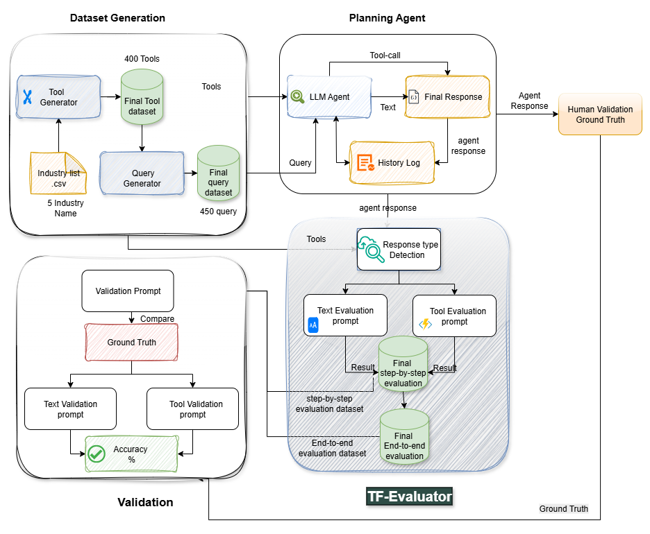

# **GPT-EVAL: Agent-centric evaluation of tool calling and text responses**

This project evaluates LLM agent responses for both tool-calling and text-only cases, compares evaluator outputs against ground truth and other exsisting Evalutor (T-eval and G-eval), and produces summary metrics and figures. It also includes small datasets for query and tool generation.

## **Table of Contents**
1. [Project Overview](#project-overview)
2. [How It Works](#how-it-works)
3. [Setup Instructions](#setup-instructions)
4. [Project Structure](#project-structure)
5. [File Structure](#file-structure)
6. [Dependencies](#dependencies)
7. [License](#license)

## **Project Overview**
The goal of this project is to:
1. **Evaluate agent outputs** across two types:
   - **Tool** responses that invoke external tools with parameters.
   - **Text** responses without tool use.
2. **Score and compare** results using a structured evaluator (TF-Eval style) and a final validator.
3. **Report metrics** that include agreement rate, **Cohen’s κ**, binary **PASS/FAIL** and optional **PASS/FAIL/REFUSED** confusion matrices, and **text similarity** for text entries.

**Current split:** **708** total responses, **131** text, **577** tool.  
**Tools used in the final study:** **400**. 
**Agents :**  GPT-4.1, GPT-4.1 Mini, GPT-4.1 Nano, GPT-4o, GPT-4o mini, o1 (reasoning), o3 (reasoning). 
**Evaluators:** agent outputs from **GPT-4o**, evaluated by **GPT-4.1**, **GPT-4.1 Mini**, **GPT-4.1 Nano**, and **GPT-4o** with the same schema.

### **Components**
1. **TF-Eval**: structured evaluator that assigns  
   - **Verdict**: `PASS`, `FAIL`, `REFUSED`  
   - **Satisfaction level**: `Poor`, `Fair`, `Good`, `Excellent` (mapped to 0–6)  
   - **Reference usage**: boolean flag when references are required  
   - **Text fields**: completeness, clarity, relevance, contextual adaptation  
   - **Tool fields**: parameter accuracy, tool validity, redundancy or misuse
2. **Validator (`validation_final.py`)**: normalizes evaluator outputs, matches by `(QueryID, type)`, computes field-level agreement and κ, builds confusion matrices, and calculates text-similarity scores for text items.
3. **Baseline comparisons (T-Eval and G-Eval)**: we run side-by-side checks of our evaluator against T-Eval for tool entries and G-Eval for text entries. Outputs include verdict agreement, κ, and confusion matrices.
4. **Datasets**: scripts for **Query Generation** and **Tool Generation** used to create the evaluation set.

## **How It Works**

### 1. **Data inputs**
- **Agent input**: `Finalqueryset.jsonl`, `Finaltoolset.jsonl`
- **Ground truth**: `groundtruth_final_only.jsonl`
- **Agreement input**: pre-evaluated sets per model for reference

### 2. **Run evaluators (TF-Eval)**
- Execute `TF-Eval.py` on each model’s agent output to produce evaluator JSONL files with verdicts and scores.

### 3. **Validation and metrics**
- Run `validation_final.py` to:
  - Normalize fields and align records by `(QueryID, type)`
  - Compute verdict agreement and **Cohen’s κ**
  - Build confusion matrices for **PASS/FAIL** and optionally **PASS/FAIL/REFUSED**
  - For `type == "text"`, compute **cosine similarity**, **BERTScore-F1**, and **ROUGE-L F1**
  - Optionally call Azure OpenAI only to generate a short reason for mismatches (no re-evaluation)

### 4. **Step-by-step and end-to-end evaluation**
- **Step-by-step (SbS)** checks each intermediate step and tool call for validity and alignment.
- **End-to-end (E2E)** evaluates only the final answer.
- The repo includes outputs and figures to compare SbS and E2E and to highlight where a good final answer hides intermediate failures.

### 5. **Baseline comparisons with T-Eval and G-Eval**
- **G-Eval comparison (text):** set the validator’s **ground truth** to your G-Eval labels for text entries and the **evaluation** to your TF-Eval outputs. The validator reports agreement, κ, and confusion matrices.
- **T-Eval comparison (tool):** set the validator’s **ground truth** to your T-Eval labels for tool entries and the **evaluation** to your TF-Eval outputs. Same reports as above.


## **Setup Instructions**

### 1. **Clone the repository**
```bash
git clone git@github.com:IntelligenceMiners/GPT-Eval.git
   ```
### 2. **Install the dependencies**:
   Install the required Python libraries by running the following command:

   ```bash
   pip install -r requirements.txt
   ```

### 3. **Azure OpenAI Setup**:
   - You need to set up an **Azure OpenAI API** account and configure the necessary environment variables:
# Windows (PowerShell)
$env:ENDPOINT_URL="https://<your-endpoint>.openai.azure.com/"
$env:DEPLOYMENT_NAME="gpt-4o-2024-08-06-global"

# macOS/Linux (bash)
export ENDPOINT_URL="https://<your-endpoint>.openai.azure.com/"
export DEPLOYMENT_NAME="gpt-4o-2024-08-06-global"


### 4. **Prepare Your Dataset**
- Provide these **JSONL** files:
  - `Finalqueryset.jsonl` (query set)
  - `Finaltoolset.jsonl` (tool set)
  - `groundtruth_final_only.jsonl` (ground-truth evaluations)
- **Format:** JSON Lines (one JSON object per line). Each item should include `QueryID` and `type` (`"tool"` or `"text"`).

---

### 5. **Run the Script**

**A Run the structured evaluator (TF-Eval) on a model output**

- **Windows (PowerShell):**
```bash
python "scripts/evaluator pipeline/TF-Eval.py" ^
  --input "output files/Agent Final outputs/Model4o.jsonl" ^
  --out   "output files/evaluator output/Model4o/eval.jsonl"
  ```
- **macOS/Linux (bash):**
```bash
python "scripts/evaluator pipeline/TF-Eval.py" ^
  --input "output files/Agent Final outputs/Model4o.jsonl" ^
  --out   "output files/evaluator output/Model4o/eval.jsonl"
  ```
## **Project Structure Diagram**

Here is the project structure diagram:


## **File Structure**

Here’s the breakdown of the file structure:

```
GPT-EVAL/
├─ input data/
│  ├─ agent input/
│  │  ├─ Finalqueryset.jsonl
│  │  └─ Finaltoolset.jsonl
│  ├─ agreemment input/
│  │  ├─ evaluatedMA_data.jsonl
│  │  ├─ evaluatedMA_data4.1.jsonl
│  │  ├─ evaluatedMA_data4.1Mini.jsonl
│  │  └─ evaluatedMA_data4o.jsonl
│  └─ evaluator input/
│     ├─ groundtruth_final_only.jsonl
│     ├─ Finaltoolset.jsonl
│     └─ Model4o.jsonl
├─ output files/
│  ├─ Agent Final outputs/
│  │  ├─ Model03REASONING.jsonl
│  │  ├─ Model4.1.jsonl
│  │  ├─ Model4.1mini.jsonl
│  │  ├─ Model4.1NANO.jsonl
│  │  ├─ Model4o.jsonl
│  │  ├─ Model4omini.jsonl
│  │  ├─ Model01REASONING.jsonl
│  │  └─ Modelteval.jsonl
│  ├─ agreement output/
│  │  ├─ modelBasedResults_consistency_optimized/
│  │  └─ endToEnd_Evaluation.jsonl
│  └─ evaluator output/
│     ├─ Model4.1/
│     ├─ Model4.1Mini/
│     ├─ Model4.1Nano/
│     ├─ Model4o/
│     ├─ endToEnd_Evaluation.jsonl
│     └─ groudtruth_final.jsonl         
├─ scripts/
│  └─ evaluator pipeline/
│     ├─ Agentresponse.py
│     ├─ TF-Eval.py
│     ├─ EndToEnd_Evaluation.py            # NEW: E2E and SBS (Agreement)
│     └─ validation.py                 
│    
├─ validation_final.py
└─ Tool and Query Generation/
   ├─ Query Generation/
   └─ Tool Generation/

```

## **Dependencies**


- **Python 3.8+**
- **openai**: OpenAI API client
- **azure-identity**: Azure authentication
- **scikit-learn**: metrics (kappa, confusion matrix, reports)
- **sentence-transformers**: text embeddings for cosine similarity
- **bert-score**: BERTScore-F1
- **rouge-score**: ROUGE-L F1
- **tqdm**: progress bars
- **matplotlib**: plots for confusion matrices
- **seaborn**: heatmaps for confusion matrices

Install with:
```bash
pip install -r requirements.txt
```

## **License**

This project is licensed under the MIT License - see the [LICENSE](LICENSE) file for details.
