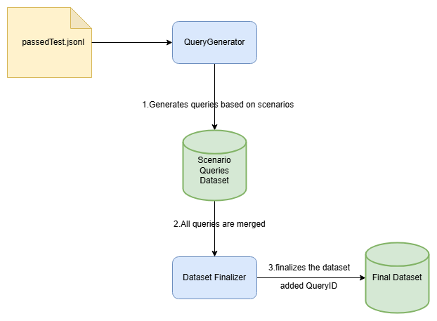

# **Industry Query Generator and Dataset Finalizer**

This project is designed to generate queries tailored to different industries using tools powered by OpenAI. It tracks the progress of query generation, finalizes the dataset, and ensures that each query is linked to a specific industry and scenario. The core functionality includes generating queries for various industries, checking if they make sense, and adding unique identifiers to the dataset for easier tracking and analysis.

## **Table of Contents**
1. [Project Overview](#project-overview)
2. [How It Works](#how-it-works)
3. [Setup Instructions](#setup-instructions)
4. [Project Structure](#project-structure)
5. [File Structure](#file-structure)
6. [Dependencies](#dependencies)
7. [License](#license)

## **Project Overview**
The goal of this project is to:
1. **Generate Queries** for different industries based on predefined scenarios in the dataset.
2. **Finalize the Dataset** by adding `IndustryID`, `ScenarioID`, and `QueryId` for better tracking and management.
3. **Save the Data** into structured files in JSONL format.

### **Components**:
1. **QueryGenerator**: This script generates queries based on industry scenarios. Each query is linked to a particular tool and industry.
2. **Finalizer**: This script reads the dataset, processes the scenarios, and adds the necessary identifiers (`IndustryID`, `ScenarioID`, and `QueryId`) to the final dataset.
3. **Input File**: Includes file that contain industry and tool data in JSONL format.
4. **Result**: The processed dataset is stored in `JSONL` files.

## **How It Works**

### 1. **Query Generation**:
   - The `QueryGenerator` reads input files `Result\4o-08-06\passedTest.jsonl`, containing industry ID and tool requirements.
   - It generates queries based on each scenarios described in the prompt. The generated queries are structured to test specific tools and industries in different contexts.

### 2. **Dataset Finalization**:
   - The `Result\Infomation\output.json` contains Scenario details for each scenario (`Scenario`, `ScenarioID`, and `Message`) . 
   - The `Result\QuerySet\Finalizer.py` marge all the dataset and adds `IndustryID`, `ScenarioID`, and `QueryId` to each generated query. 
   - The final dataset is saved to new JSONL file combining each scenario 'Result\QuerySet\Final_dataset.jsonl'.
   - This helps to track and manage the dataset, ensuring each query is uniquely identifiable.

## **Setup Instructions**

### 1. **Clone the repository**:
   To get started with the project, clone the repository to your local machine:

   ```bash
   git clone git@github.com:IntelligenceMiners/UniveralToolKits.git


### 2. **Install the dependencies**:
   Install the required Python libraries by running the following command:

   ```bash
   pip install -r requirements.txt
   ```

### 3. **Azure OpenAI Setup**:
   - You need to set up an **Azure OpenAI API** account and configure the necessary environment variables:
     - `ENDPOINT_URL`: Your Azure OpenAI endpoint.
     - `DEPLOYMENT_NAME`: The deployment name of the OpenAI model (e.g., `gpt-4o-2024-08-06-global`).

### 4. **Prepare Your Dataset**:
   - The dataset should be in a CSV file (`Industries.csv`), which includes a list of industries to generate tools for.

### 5. **Run the Script**:
   To run the script, execute the following command:

      ```bash
      python run.py
      ```

## **Project Structure Diagram**

Here is the project structure diagram:




## **File Structure**

Here’s the breakdown of the file structure:

```
UniveralToolKits/
├── assets/                             # Folder for project-related assets
│   ├── PipelineFlow.png                # Diagram for project pipeline flow
│   
├── code/                               # Folder containing main Python scripts
│   ├── QueryGenerator.py               # Script for generating queries based on scenarios
│   ├── run.py                          # Script for executing the query generation process
│   
│   
├── Input/                              # Folder for input files
│   ├── industries.csv                  # CSV file with list of industries
│   ├── IndustryGenerator.csv           # Industry generator data (if available)
│
├── Result/                             # Folder for the results of the generated queries
│   ├── 4o-08-06                        # Folder for OpenAI model results (e.g., queries generated, passed/failed tests)
│   │   ├── final02.jsonl               # Query results for final02
│   │   ├── final05.jsonl               # Query results for final05
│   │   ├── passedTest.jsonl            # Passed test results
│   │   ├── queries02.jsonl            # Query generation for scenario 02
│   │   └── queries05.jsonl            # Query generation for scenario 05
│   │
│   ├── Information/                    # Folder for project-related information and logs
│   │   ├── Final.json                  # Final output file (if generated)
│   │   ├── Finalizer.py                # Finalization script
│   │   ├── output.json                 # Processed output file (e.g., results of finalizations)
│   │   ├── sc07.py                     # Python script related to scenario 07 (if available)
│   │   ├── sc010405pri.py              # Python script related to scenario 010405 (if available)
│   │   └── sc030608 1.py               # Python script related to scenario 030608 (if available)
│
│   └── QuerySet/                       # Folder for the final datasets and query generation results
│       ├── Scenario_Final_dataset/     # Folder containing the final datasets for each scenario
│       │   ├── final01.jsonl           # Final dataset for scenario 01
│       │   ├── final02.jsonl           # Final dataset for scenario 02
│       │   ├── final03.jsonl           # Final dataset for scenario 03
│       │   ├── final04.jsonl           # Final dataset for scenario 04
│       │   ├── final05.jsonl           # Final dataset for scenario 05
│       │   ├── final05prime.jsonl      # Final dataset for scenario 05 prime
│       │   ├── final06.jsonl           # Final dataset for scenario 06
│       │   ├── final07.jsonl           # Final dataset for scenario 07
│       │   ├── final08.jsonl           # Final dataset for scenario 08
│       │   └── Final_dataset.jsonl     # Consolidated final dataset with all scenarios
│       │
│       ├── Final_dataset.jsonl         # Consolidated final dataset of all queries and scenarios
│       └── Finalizer.py                # Script for finalizing the dataset and adding unique identifiers
│
├── .gitignore                          # Git ignore file to prevent unnecessary files from being committed
├── README.md                           # Project documentation
├── requirements.txt                    # Python dependencies required for the project
└── .env                                # Environment variables file (if required)

```

## **Dependencies**

- **Python 3.8+**
- **pandas**: For handling CSV files and datasets.
- **openai**: For interacting with the OpenAI API.
- **azure-identity**: For Azure authentication.
- **json**: For working with JSON data.
- **re**: For regular expressions used in data processing.
- **jsonlines**: For working with JSONL files.


You can install the dependencies using:

```bash
pip install -r requirements.txt
```

## **License**

This project is licensed under the MIT License - see the [LICENSE](LICENSE) file for details.
